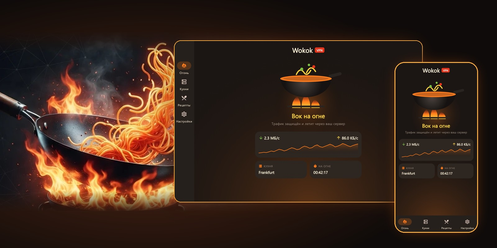
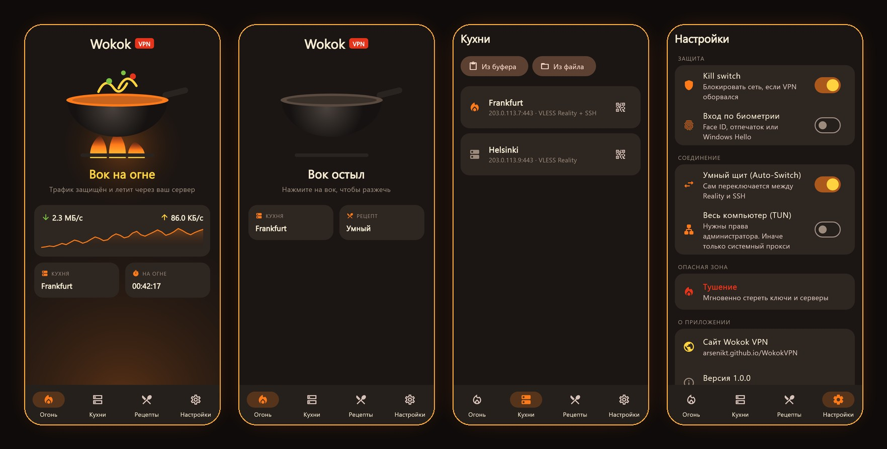
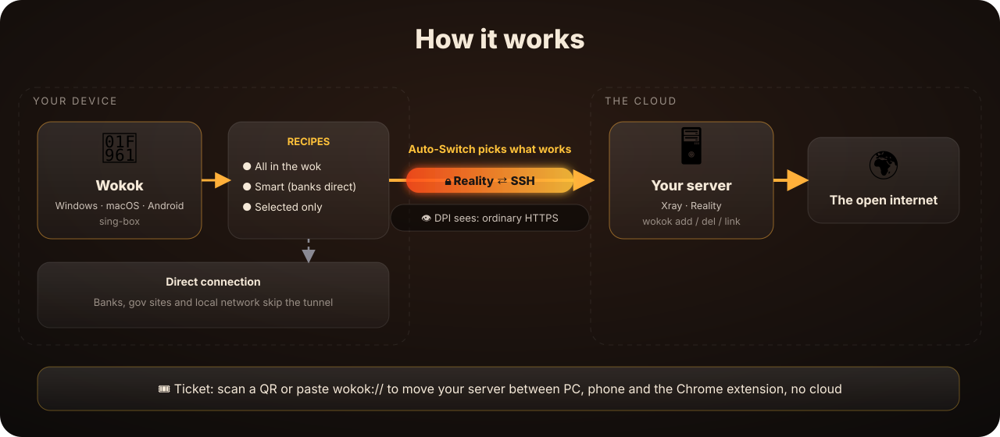

<div align="center">


# 🥡 Wokok Box: apps

### Your own unblockable VPN for Windows, macOS, Android and iOS: scan a ticket, tap the wok.

**VLESS + Reality** that looks like ordinary HTTPS · **SSH fallback with Auto-Switch** · **Recipes: smart routing** · **Kill switch**

[](https://github.com/arsenikt/WokokVPN-App/releases/latest/download/WokokVPN-windows-x64.zip)
[](https://github.com/arsenikt/WokokVPN-App/releases/latest/download/WokokVPN-macos.dmg)
[](https://github.com/arsenikt/WokokVPN-App/releases/latest/download/WokokVPN-android-arm64.apk)
[](https://github.com/arsenikt/WokokVPN-App/releases/latest/download/WokokVPN-ios-unsigned.ipa)

[](LICENSE)
[](https://github.com/arsenikt/WokokVPN-App/releases)
[](https://github.com/arsenikt/WokokVPN-App/actions)


**English** · [Русский](README.ru.md) · [Website](https://arsenikt.github.io/WokokVPN) · [Chrome extension](https://github.com/arsenikt/WokokVPN-Chrome)



</div>

> **Now Wokok Box.** Besides the VPN: **Tunnel** (your own ngrok), **Deploy** (your VPS without a terminal), **Spy Check** (who is watching you) and **Guard** (scam protection). See [docs/BOX.md](docs/BOX.md).

---

## Why Wokok?

Commercial VPNs get blocked, sell your data and slow everything down, including your bank. Wokok runs on **your own $3/month server**, disguises itself as normal traffic to a big website, and sends **only the sites you want** through the tunnel. One server, one **ticket**, every device.

| | Wokok VPN | Typical VPN app |
|---|---|---|
| Your own server, your own keys | ✅ | ❌ shared IPs |
| Survives DPI (Reality looks like HTTPS to `microsoft.com`) | ✅ | ❌ |
| Falls back to SSH by itself when a channel is cut | ✅ Auto-Switch | ❌ |
| Banks & government sites stay direct | ✅ Smart recipe | ❌ |
| Accounts, telemetry, ads | ❌ none | sometimes |
| Same server in the Chrome extension | ✅ one QR | ❌ |
| Price | your VPS | $5–12/mo |
| Open source | ✅ MIT | ❌ |

## 📲 Screens



<sub>The wok is the button: grey when cold, amber while heating, blazing with noodles in the air when you are protected.</sub>

## ⚡ Quick start

### 1. Your server (once)

```bash
curl -fsSL https://raw.githubusercontent.com/arsenikt/WokokVPN-Chrome/main/server/install.sh | sudo bash
```

About 30 seconds later you get a **`wokok://` ticket**, a **`vless://` link** and a **QR code**. Details and the `wokok` command cheat sheet live in the [server docs](https://github.com/arsenikt/WokokVPN-Chrome#-server-cheat-sheet).

### 2. The app

| Platform | File | How |
|---|---|---|
| 🪟 **Windows 10/11** | `WokokVPN-windows-x64.zip` | Unzip and run `wokok_vpn.exe`. SmartScreen may warn because builds are not code-signed yet. |
| 🍎 **macOS** | `WokokVPN-macos.dmg` | Drag to Applications. First launch: right-click → **Open**. |
| 🤖 **Android 6+** | `WokokVPN-android-arm64.apk` (also `armv7`, `x86_64`) | Allow installs from this source, then open the APK. |
| 📱 **iOS** | `WokokVPN-ios-unsigned.ipa` | Install with [AltStore](https://altstore.io) or [Sideloadly](https://sideloadly.io). The build is not Apple-signed. |

Every release ships a `SHA256SUMS.txt`.

### 3. Tap the wok

Open **Kitchens** → **Scan QR** (or paste from the clipboard / pick a file) → tap the wok. 🔥

> 🎟 **Ticket from the Chrome extension?** It is the same `wokok://` format. Scan it, and the app picks up the Reality server and the SSH fallback key.

## ✨ Features

- 🔥 **Live button.** The wok cools, heats and blazes with the connection state, with a live speed graph.
- 🛡 **Auto-Switch.** sing-box tests VLESS + Reality and the SSH tunnel in the background and uses the one that works in your network.
- 🍳 **Recipes.** *All in the wok* (everything through VPN), *Smart* (banks and government sites direct) and *Selected only* (your own list).
- 🎟 **Tickets.** A QR or `wokok://` link moves a server between PC, phone and the Chrome extension. No cloud, no accounts.
- 🧯 **Kill switch.** Strict route in TUN mode blocks traffic outside the tunnel; on Android use *Always-on VPN* + *Block connections without VPN*.
- 🔐 **Keys stay safe.** Servers and keys live in the platform keystore (Keychain / Keystore / DPAPI). No telemetry.
- 🫆 **Biometric lock.** Face ID, fingerprint or Windows Hello on launch.
- 🚨 **Extinguish.** One button wipes every server, key and setting from the device.
- 🖥 **Tray and menu bar.** Closing the window keeps the VPN running; toggle it from the tray.
- 🎨 **Native feel.** Material 3 on Android, Cupertino tab bar on iOS, sidebar with tray on Windows and macOS. The wok brand stays the same everywhere.

## 🔬 How it works



- **App (Flutter).** One UI and one state layer for four platforms. It turns your server and recipe into a [sing-box](https://github.com/SagerNet/sing-box) config and hands it to the core.
- **Core.** On Windows and macOS sing-box runs as a bundled sidecar (system proxy by default, optional full-system TUN). On Android it runs inside a `VpnService` through `libbox`, built from the same sing-box version in CI.
- **Server.** Xray Reality with a separate UUID per user, plus a restricted `wokok` SSH user as the fallback. See [WokokVPN-Chrome](https://github.com/arsenikt/WokokVPN-Chrome).

## 🧭 Platform status

| Platform | UI | Core | Notes |
|---|---|---|---|
| Windows | ✅ | ✅ sing-box sidecar | System proxy; TUN needs administrator rights |
| macOS | ✅ | ✅ sing-box in `Resources/core` | Sandbox is off so the core can start; not notarized |
| Android | ✅ | ✅ `VpnService` + `libbox` | Builds in CI; not yet tested on real devices, reports are welcome |
| iOS | ✅ | 🧪 Packet Tunnel + `Libbox` | Builds in CI, never run on a device. The tunnel only works with your own signing and a paid Apple Developer account, see [docs/IOS.md](docs/IOS.md) |

## 🛠 Build from source

```bash
flutter pub get
flutter test
flutter build windows --release        # or: macos / ios --no-codesign
bash tools/build_libbox.sh             # Android only: builds the sing-box core (needs Go, JDK 17, Android NDK)
flutter build apk --release
```

On desktop, put `sing-box` 1.11.x into a `core/` folder next to the executable (CI does it for you).
Tag `vX.Y.Z` and GitHub Actions builds every platform, writes `SHA256SUMS.txt` and publishes the release.

### 🎨 Artwork

All artwork is generated in Gemini. The prompt pack is in [docs/gemini/PROMPTS.md](docs/gemini/PROMPTS.md), and `python tools/import_gemini.py` cuts the renders into every size the app and site need.

## ❓ FAQ

<details><summary>Do I need an account or a subscription?</summary>
No. You own the server and the keys. There is no backend, no account and no telemetry.
</details>

<details><summary>Windows says "unknown publisher"</summary>
Builds are not code-signed yet, so SmartScreen shows a warning. Check the file against <code>SHA256SUMS.txt</code> from the release, then choose <b>More info → Run anyway</b>.
</details>

<details><summary>How do I get my server onto the phone?</summary>
Open <b>Kitchens</b> on any Wokok device or the Chrome extension, show the ticket QR, and scan it on the phone. A pasted <code>wokok://</code> or <code>vless://</code> link works too.
</details>

<details><summary>What is the difference between system proxy and TUN on desktop?</summary>
System proxy needs no rights and covers apps that respect it. TUN (<i>Settings → Whole computer</i>) captures everything but needs administrator rights.
</details>

<details><summary>Is it legal?</summary>
Wokok is a tool for private access to your own server. Follow the laws of your country.
</details>

## 🤝 Contributing

PRs are welcome. Good first issues: translations, new recipes, testing the iOS tunnel on a real device, widget tests. If Wokok saved your evening, a ⭐ helps others find it.

### 🥡 Buy the author a wok

Free forever. If Wokok saved your evening, toss a coin into the wok, because the old one is overheating from all that traffic.

- **EVM** (ETH · BSC · Base · Polygon): `0x0aA2d41976f087763a354d598D32c21E1983CbFD`
- **Solana**: `E1M7Ztc1MGnc587mmhk2dqBn2rWc4dXyx8huQ2HHpQjt`
- **TRON** (USDT TRC-20): `TXTrfbxAuy63ngzfWNiqubb2y2DHVqWbg9`

## License

App source code: [MIT](LICENSE).

Release binaries bundle [sing-box](https://github.com/SagerNet/sing-box) (GPL-3.0 with a name-use clause): as a separate executable on Windows and macOS, and linked in as `libbox` on Android. Those binaries are therefore distributed under the terms of the GPL-3.0; the sing-box source is at the link above and is pinned to v1.11.15.
