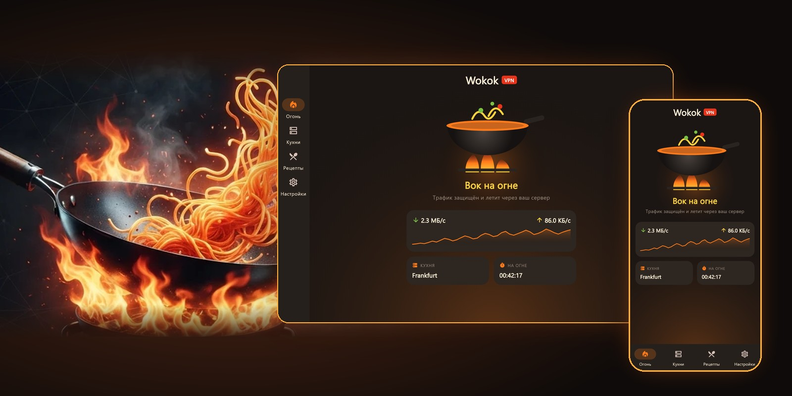
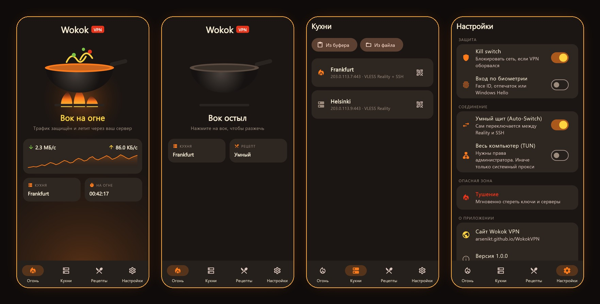
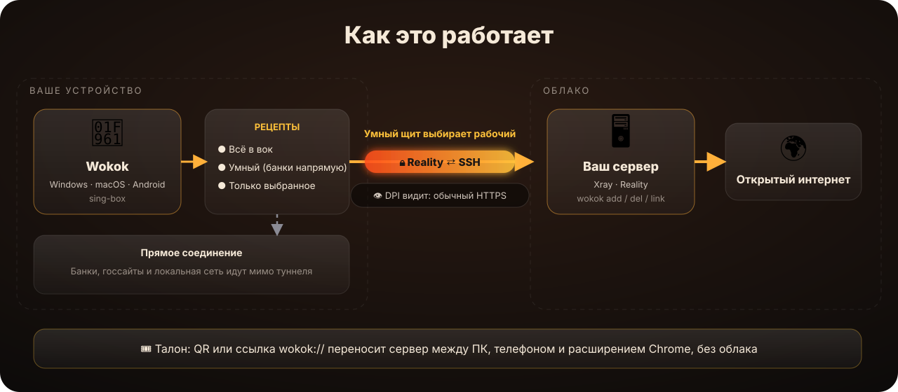

<div align="center">


# 🥡 Wokok VPN: приложения

### Свой неблокируемый VPN для Windows, macOS, Android и iOS: отсканируйте талон и нажмите на вок.

**VLESS + Reality** выглядит как обычный HTTPS · **запасной SSH с автопереключением** · **Рецепты: умная маршрутизация** · **Kill switch**

[](https://github.com/arsenikt/WokokVPN-App/releases/latest/download/WokokVPN-windows-x64.zip)
[](https://github.com/arsenikt/WokokVPN-App/releases/latest/download/WokokVPN-macos.dmg)
[](https://github.com/arsenikt/WokokVPN-App/releases/latest/download/WokokVPN-android-arm64.apk)
[](https://github.com/arsenikt/WokokVPN-App/releases/latest/download/WokokVPN-ios-unsigned.ipa)

[](LICENSE)
[](https://github.com/arsenikt/WokokVPN-App/releases)
[](https://github.com/arsenikt/WokokVPN-App/actions)


[English](README.md) · **Русский** · [Сайт](https://arsenikt.github.io/WokokVPN) · [Расширение для Chrome](https://github.com/arsenikt/WokokVPN-Chrome)



</div>

---

## Зачем Wokok?

Коммерческие VPN блокируют, они продают данные и тормозят всё подряд, включая банк. Wokok работает на **вашем собственном сервере за 300 ₽ в месяц**, маскируется под обычный трафик к крупному сайту и пускает через туннель **только нужные сайты**. Один сервер, один **талон**, все устройства.

| | Wokok VPN | Обычное VPN-приложение |
|---|---|---|
| Свой сервер и свои ключи | ✅ | ❌ общие IP |
| Переживает DPI (Reality выглядит как HTTPS к `microsoft.com`) | ✅ | ❌ |
| Сам уходит на SSH, если канал режут | ✅ Умный щит | ❌ |
| Банки и госсайты идут напрямую | ✅ рецепт «Умный» | ❌ |
| Аккаунты, телеметрия, реклама | ❌ нет | бывает |
| Тот же сервер в расширении Chrome | ✅ один QR | ❌ |
| Цена | ваш VPS | 400–1000 ₽/мес |
| Открытый код | ✅ MIT | ❌ |

## 📲 Экраны



<sub>Вок и есть кнопка: серый, когда остыл, янтарный при разогреве, и горит с летящей лапшой, когда вы под защитой.</sub>

## ⚡ Быстрый старт

### 1. Ваш сервер (один раз)

```bash
curl -fsSL https://raw.githubusercontent.com/arsenikt/WokokVPN-Chrome/main/server/install.sh | sudo bash
```

Через ~30 секунд вы получите **талон `wokok://`**, ссылку **`vless://`** и **QR-код**. Подробности и шпаргалка по команде `wokok` в [документации сервера](https://github.com/arsenikt/WokokVPN-Chrome/blob/main/README.ru.md).

### 2. Приложение

| Платформа | Файл | Как поставить |
|---|---|---|
| 🪟 **Windows 10/11** | `WokokVPN-windows-x64.zip` | Распакуйте и запустите `wokok_vpn.exe`. SmartScreen может предупредить, сборки пока не подписаны. |
| 🍎 **macOS** | `WokokVPN-macos.dmg` | Перетащите в «Программы». Первый запуск: правый клик → **Открыть**. |
| 🤖 **Android 6+** | `WokokVPN-android-arm64.apk` (есть `armv7`, `x86_64`) | Разрешите установку из этого источника и откройте APK. |
| 📱 **iOS** | `WokokVPN-ios-unsigned.ipa` | Через [AltStore](https://altstore.io) или [Sideloadly](https://sideloadly.io). Сборка без подписи Apple. |

В каждом релизе есть `SHA256SUMS.txt`.

### 3. Нажмите на вок

Откройте **Кухни** → **Сканировать QR** (или вставьте из буфера, или выберите файл) → нажмите на вок. 🔥

> 🎟 **Талон из расширения Chrome?** Формат тот же, `wokok://`. Отсканируйте его, и приложение возьмёт сервер Reality и ключ запасного SSH.

## ✨ Возможности

- 🔥 **Живая кнопка.** Вок остывает, разогревается и горит вместе с состоянием соединения, рядом живой график скорости.
- 🛡 **Умный щит (Auto-Switch).** sing-box в фоне проверяет VLESS + Reality и SSH-туннель и пользуется тем, что работает в вашей сети.
- 🍳 **Рецепты.** *Всё в вок* (всё через VPN), *Умный* (банки и госсайты напрямую) и *Только выбранное* (ваш список).
- 🎟 **Талоны.** QR или ссылка `wokok://` переносит сервер между ПК, телефоном и расширением Chrome. Без облака и аккаунтов.
- 🧯 **Kill switch.** Строгий маршрут в режиме TUN блокирует трафик мимо туннеля; на Android включите *Постоянный VPN* и *Блокировать соединения без VPN*.
- 🔐 **Ключи в безопасности.** Серверы и ключи лежат в системном хранилище (Keychain / Keystore / DPAPI). Телеметрии нет.
- 🫆 **Вход по биометрии.** Face ID, отпечаток или Windows Hello при запуске.
- 🚨 **Тушение.** Одна кнопка стирает все серверы, ключи и настройки с устройства.
- 🖥 **Трей и меню-бар.** Закрытие окна не отключает VPN, переключать можно из трея.
- 🎨 **Нативный вид.** Material 3 на Android, вкладки Cupertino на iOS, боковая панель и трей на Windows и macOS. Бренд с воком везде один.

## 🔬 Как это работает



- **Приложение (Flutter).** Один интерфейс и один слой состояния на четыре платформы. Превращает ваш сервер и рецепт в конфиг [sing-box](https://github.com/SagerNet/sing-box) и передаёт его ядру.
- **Ядро.** На Windows и macOS sing-box запускается как встроенный процесс (по умолчанию системный прокси, по желанию TUN на весь компьютер). На Android он работает внутри `VpnService` через `libbox`, который в CI собирается из той же версии sing-box.
- **Сервер.** Xray Reality с отдельным UUID на каждого пользователя и ограниченный SSH-пользователь `wokok` как запасной канал. См. [WokokVPN-Chrome](https://github.com/arsenikt/WokokVPN-Chrome).

## 🧭 Состояние платформ

| Платформа | UI | Ядро | Примечания |
|---|---|---|---|
| Windows | ✅ | ✅ sing-box как sidecar | Системный прокси; TUN требует прав администратора |
| macOS | ✅ | ✅ sing-box в `Resources/core` | Sandbox выключен, чтобы запускать ядро; без нотаризации |
| Android | ✅ | ✅ `VpnService` + `libbox` | Собирается в CI; на реальных устройствах пока не проверялось, отзывы приветствуются |
| iOS | ✅ | 🧪 Packet Tunnel + `Libbox` | Собирается в CI, на устройстве не запускался. Туннель работает только с вашей подписью и платным Apple Developer, см. [docs/IOS.md](docs/IOS.md) |

## 🛠 Сборка из исходников

```bash
flutter pub get
flutter test
flutter build windows --release        # или: macos / ios --no-codesign
bash tools/build_libbox.sh             # только Android: собирает ядро sing-box (нужны Go, JDK 17, Android NDK)
flutter build apk --release
```

На десктопе положите `sing-box` 1.11.x в папку `core/` рядом с исполняемым файлом (CI делает это сам).
Поставьте тег `vX.Y.Z`, и GitHub Actions соберёт все платформы, посчитает `SHA256SUMS.txt` и опубликует релиз.

### 🎨 Графика

Вся графика делается в Gemini. Набор промптов лежит в [docs/gemini/PROMPTS.md](docs/gemini/PROMPTS.md), а `python tools/import_gemini.py` нарежет результаты во все нужные размеры.

## ❓ Вопросы

<details><summary>Нужен ли аккаунт или подписка?</summary>
Нет. Сервер и ключи ваши. Бэкенда, аккаунтов и телеметрии нет.
</details>

<details><summary>Windows пишет «неизвестный издатель»</summary>
Сборки пока не подписаны сертификатом, поэтому SmartScreen показывает предупреждение. Сверьте файл с <code>SHA256SUMS.txt</code> из релиза, затем нажмите <b>Подробнее → Выполнить в любом случае</b>.
</details>

<details><summary>Как перенести сервер на телефон?</summary>
Откройте <b>Кухни</b> на любом устройстве Wokok или в расширении Chrome, покажите QR талона и отсканируйте его телефоном. Подойдёт и вставка ссылки <code>wokok://</code> или <code>vless://</code>.
</details>

<details><summary>Чем на компьютере системный прокси отличается от TUN?</summary>
Системный прокси не требует прав и работает для программ, которые его уважают. TUN (<i>Настройки → Весь компьютер</i>) перехватывает всё, но нужны права администратора.
</details>

<details><summary>Это законно?</summary>
Wokok это инструмент для приватного доступа к вашему собственному серверу. Соблюдайте законы своей страны.
</details>

## 🤝 Участие

PR приветствуются. Хорошие первые задачи: переводы, новые рецепты, проверка туннеля iOS на реальном устройстве, виджет-тесты. Если Wokok выручил вас вечером, ⭐ помогает другим его найти.

### 🥡 Угостить автора воком

Бесплатно навсегда. Если Wokok выручил, бросьте монетку в вок, а то старый перегревается от всего этого трафика.

- **EVM** (ETH · BSC · Base · Polygon): `0x0aA2d41976f087763a354d598D32c21E1983CbFD`
- **Solana**: `E1M7Ztc1MGnc587mmhk2dqBn2rWc4dXyx8huQ2HHpQjt`
- **TRON** (USDT TRC-20): `TXTrfbxAuy63ngzfWNiqubb2y2DHVqWbg9`

## Лицензия

Исходный код приложения: [MIT](LICENSE).

В готовые сборки входит [sing-box](https://github.com/SagerNet/sing-box) (GPL-3.0 с оговоркой об использовании имени): отдельным исполняемым файлом на Windows и macOS и подключённым как `libbox` на Android. Поэтому эти бинарники распространяются на условиях GPL-3.0; исходники sing-box по ссылке выше, версия закреплена на v1.11.15.
